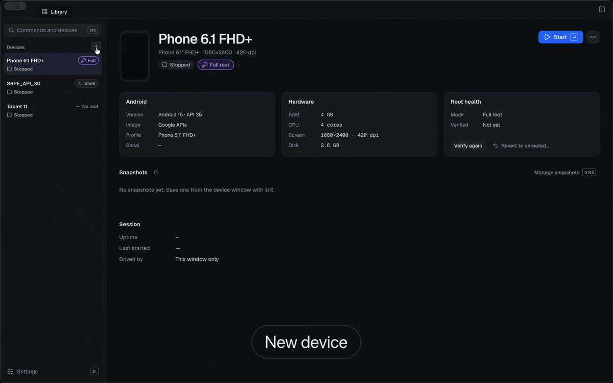
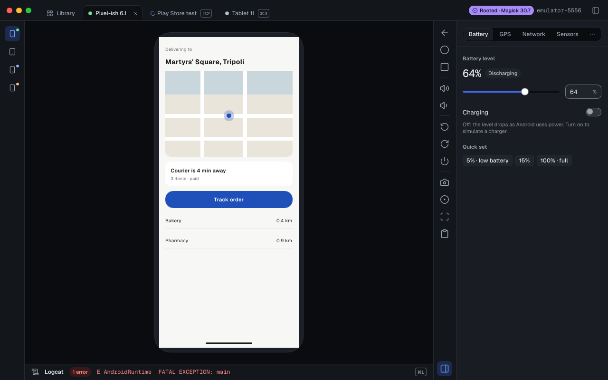

# Jidr (جذر)

Android on your Mac, rooted in a minute.

[](https://github.com/AbdurahmanAlmehdi/jidr/releases/latest)


Jidr creates and runs virtual Android phones and tablets on Apple Silicon Macs. Pick **Full root** and Magisk is patched in and verified for you; pick **Shell root** for `adb root`; or keep the device stock. It's a free, open-source alternative to Genymotion Desktop, written in Rust, with a desktop app, a CLI and an MCP server for AI agents.

```bash
brew install --cask abdurahmanalmehdi/tap/jidr
```

Or [download the DMG](https://github.com/AbdurahmanAlmehdi/jidr/releases/latest). Site: [jidr.ly](https://jidr.ly). News: [@Jidr_ly on X](https://x.com/Jidr_ly).



## Features

- **Devices:** create, clone, start, stop and delete virtual devices from Google's emulator images (API 29–36, arm64). Jidr keeps its own SDK and never modifies Android Studio's SDK or AVDs.
- **One-click root:** None, Shell root (`adb root`) or Full root (Magisk, patched into a per-device copy of the ramdisk and verified with `su -c id`). Revert at any time. Play Store images get a guided beta.
- **Player window:** the device screen with mouse and keyboard input, drag-and-drop for APKs and files, and logcat.
- **Game window:** open a running device with **Game window** in the Library (or the external-window icon in its player). A separate compact window keeps its device binding while you use the Library or open other devices. The screen fits without cropping and follows portrait or landscape rotation; its side bar provides navigation, volume, rotation, screenshots and fullscreen. Close the window to end its display session without stopping the device.
- **Installed games and apps:** the device center lists launchable user-installed apps for the selected running device; click an item to open it in the game window. Names and PNG icons are read from the APK's small metadata files using SDK build tools when available; unavailable resources fall back to package names and a generic icon. Switching devices discards stale results.
- **Quit:** quitting the app syncs and gracefully stops running devices before ending the daemon. Active jobs or an unverified stop keep the app open so no process is force-killed.
- **Text editing:** after focusing an Android text field in a game window, use ⌘C / ⌘X / ⌘V for text clipboard operations, ⌘A to select all, ⌘Z to undo and ⇧⌘Z or ⌘Y to redo. Clipboard text is transferred only when you use copy, cut or paste; Android apps must support the relevant editing action.
- **Mac input methods:** with key mapping disabled, click an Android text field and compose using the Mac input method. Committed text is sent using Android's clipboard; the Mac clipboard is not changed. The message icon also opens a manual text panel for apps that need it. Android fields must support paste.
- **Window preferences:** the game window remembers position, size, sidebar and pin state per device. The settings icon offers size presets and always-on-top; an off-screen saved position is not restored.
- **Game-window performance:** the gauge panel shows received frame rate, frame size, sampled emulator memory and an estimated touch-to-next-frame interval. Smooth mode requests a smaller image; clear mode requests the normal resolution. The figures depend on device activity and do not measure full input-to-photon latency.
- **Game-window file drops:** drop an APK to install it, or another file to copy it to the device's Download folder. ZIP files are copied rather than installed as root modules. Errors and progress are shown in the same device window; incompatible signatures do not cause automatic uninstallation.
- **Game-window shortcuts:** the help icon lists configurable shortcuts for screenshot, fullscreen, sidebar, performance and text input. Shortcuts are stored per device and separate from game key mappings.
- **Click mapping:** in a game window, open the keyboard icon, choose **Edit**, click a screen position and press a letter, number or Space. Reassign a key to move it; right-click a marker to remove it. **Save** stores one scheme per device and enables it for the current session. Bindings are specific to the screen rotation; use **Disable** before typing normally. Mapping starts disabled when a window is reopened, and hints can be hidden independently.
- **Widgets:** battery, rotation and motion sensors, network (Wi-Fi, mobile data, speed and delay profiles), calls, SMS and signal bars, GPS with GPX/KML route replay on an OpenStreetMap map, fingerprint, the host webcam as the camera, clipboard and developer toggles.
- **Media and state:** PNG screenshots, MP4 recordings, and snapshots tagged with the root mode they were taken in.
- **Build identity:** set build properties (model, brand, fingerprint…) on Full-root devices.
- **CLI:** every action is a `jidr` command, with `--json` output and stable exit codes for CI.
- **MCP server:** `jidr mcp` lets Claude and other MCP clients see and drive a device: screenshot, tap, type, UI tree, logs.

No accounts, no telemetry, no paid tier.



## Install

You need macOS 14 or later on Apple Silicon, and about 10 GB of free disk space for the SDK and one system image.

- **Homebrew:** `brew install --cask abdurahmanalmehdi/tap/jidr` installs `Jidr.app` and puts the `jidr` CLI on your `PATH`. Update with `brew upgrade --cask jidr`.
- **DMG:** download `Jidr-<version>-arm64.dmg` from the [latest release](https://github.com/AbdurahmanAlmehdi/jidr/releases/latest) and drag Jidr to Applications. The CLI is at `/Applications/Jidr.app/Contents/Helpers/jidr`.

On first launch the app finds or downloads the Android SDK and a system image, after you accept Google's license.

## Quick start (CLI)

```bash
jidr image install 35 --accept-licenses   # download an API 35 image; you accept Google's license
jidr device create Phone --image 35       # create a device
jidr device start Phone                   # boot it and wait until it's ready
jidr root set Phone magisk                # Full root with Magisk, verified
```

## Use it from an AI agent

Add Jidr to Claude Code as an MCP server:

```bash
claude mcp add jidr -- jidr mcp
```

For Claude Desktop, open `jidr-mcp-<version>-darwin-arm64.mcpb` from the [latest release](https://github.com/AbdurahmanAlmehdi/jidr/releases/latest). Jidr is also in the [MCP Registry](https://registry.modelcontextprotocol.io) as `io.github.AbdurahmanAlmehdi/jidr`. [docs/mcp.md](docs/mcp.md) lists the tools.

Agent skills teach Claude Code, Cursor, Codex and other agents to create and drive Jidr devices with the CLI (`jidr`), to test an app on them (`jidr-app-testing`), to get devices of their own without crowding the machine (`jidr-agent-devices`) and to root them, install Magisk modules and intercept HTTPS (`jidr-root`). Install them with the open [skills](https://skills.sh) CLI:

```bash
npx skills add AbdurahmanAlmehdi/jidr
```

They live in [skills/](skills/).

## Documentation

- [CLI reference](docs/cli.md)
- [MCP tools](docs/mcp.md)
- [Root modes](docs/root.md)
- [Control protocol](docs/control-protocol.md): the JSON-RPC protocol the app, the CLI and the MCP server share
- [Design system](docs/design/README.md)
- [Decisions](docs/decisions/log.md) and [architecture decision records](docs/decisions/)
- [Feature parity with Genymotion Desktop](docs/parity.md)
- [Clean-room policy](docs/clean-room.md)
- [Changelog](CHANGELOG.md)

## Build from source

```bash
git clone https://github.com/AbdurahmanAlmehdi/jidr
cd jidr
cargo build --release -p jidr -p jidr-gui
```

You need `rustup` (it installs the toolchain pinned in `rust-toolchain.toml`) and `protoc` (`brew install protobuf`). [CONTRIBUTING.md](CONTRIBUTING.md) has the full setup and how to run the tests.

## Licensing

Jidr is split-licensed. The desktop app (`crates/jidr-ui`, `apps/jidr-gui`) is **GPL-3.0-only** because it links Slint. Everything else (CLI, daemon, MCP server, libraries, site) is **Apache-2.0**. See `LICENSE-APACHE`, the `LICENSE-GPL` files in the two GUI crates, and `NOTICE`.

Jidr downloads the Android Emulator and system images from Google under the Android SDK License, which you accept in the app. It downloads Magisk (GPL-3.0) only when you choose Full root. None of these are bundled.

## Questions and contributing

Questions, ideas and setups you want to share go in [Discussions](https://github.com/AbdurahmanAlmehdi/jidr/discussions); bugs go in [Issues](https://github.com/AbdurahmanAlmehdi/jidr/issues).

Contributions are welcome: read [CONTRIBUTING.md](CONTRIBUTING.md). Report security issues as described in [SECURITY.md](SECURITY.md). If you work with an AI coding agent, point it at [AGENTS.md](AGENTS.md).

## Trademarks

Android is a trademark of Google LLC. Genymotion is a trademark of its owner. Jidr is not affiliated with Google or Genymotion.
