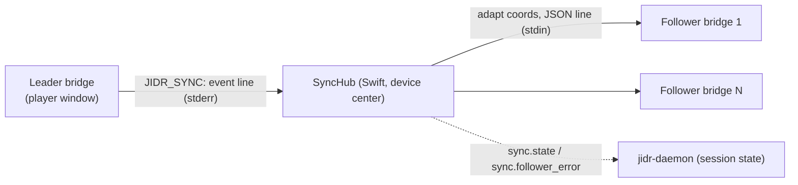

# Multi-device input synchronizer: development plan

Status: proposal. This is the implementation brief for the "Synchronizer" feature (the MuMu-style multi-instance sync). The reader is an implementing engineer or AI. Read `AGENTS.md`, `docs/player-scripts.md`, `docs/control-protocol.md` and `docs/decisions/log.md` first. Do not change an existing decision as a side effect. Add the new decision row listed in M0.

## 1. Goal and non-goals

**Goal.** The user picks several running devices. While sync is on, every input on the *leader* player window is replayed in real time on all *follower* devices: tap, swipe, multi-finger touch, hardware keys, text, paste and tool keys (back, home, recents, volume, power).

**Non-goals for v1.**
- Rotation sync, GPS or sensor sync, APK install sync, and "run on a subset" gestures.
- Cross-host sync, and sync across different backends (only the AOSP emulator backend).
- Recording or replaying a sync session as a script (a later milestone can reuse the existing script format).

## 2. Facts from the current code (verified)

| Fact | Where |
|---|---|
| Each player window runs its **own bridge process** (`jidr-center-bridge`). The GUI feeds it JSON lines on stdin (`Command`: `touch`, `mapped_touch`, `key`, `text`, `paste`, `tool_key`, …) and reads `JIDR_*:` JSON lines on stderr (e.g. `JIDR_SCRIPT:`). | `apps/jidr-swiftui/bridge/src/main.rs` (`enum Command`, the `command =>` arm near line 686) |
| Input is injected by the bridge straight to the emulator over gRPC (`sendTouch`, `sendKey`), **not** through the daemon. `InputState<W: InputWire>` tracks held touches and keys and releases them in reverse press order. | `bridge/src/player_input.rs` |
| Recorded events are normalized (`x,y` in 0…1) and serialized as `Event`. `execute_event` replays an `Event` through `InputState`. `event_fits_the_format` validates bounds. | `crates/jidr-automation/src/model.rs`, `bridge/src/script.rs` |
| While a script plays, direct user input is ignored (`is_direct_input`, `ignores_user_input`). Sync followers need the same guard. | `bridge/src/script.rs` |
| `key.press` is a daemon command; touch is **not**. | `crates/jidr-widgets/src/devtools.rs` |
| The recording panel is `PlayerScriptsWindowController`. It uses a transparent titlebar, `fullSizeContentView`, `NSVisualEffectView` with `.underWindowBackground` and `.behindWindow`, a unified-compact `NSToolbar`, and a SwiftUI `NSHostingView`. | `apps/jidr-swiftui/Sources/PlayerScripts.swift` (≈ lines 280-335) |
| Per-device single-writer locks exist; the protocol is frozen at `protocol-v0.1`, so new commands must be additive and logged. | `crates/jidr-daemon/src/locks.rs`, `docs/control-protocol.md` |

## 3. Architecture

**Control plane (daemon, protocol-visible).** The daemon owns the *session*: which devices are in it, who the leader is, and the options. It exposes `sync.*` commands, so CLI, MCP and GUI all manage sync the same way, and publishes events. This satisfies "every user action is a protocol command".

**Data plane (input events, latency-critical).** Input is already injected inside the bridge processes, so events are relayed between bridges. They do **not** round-trip through JSON-RPC:



- A leader bridge in sync mode emits every whitelisted input (the same set as `event_from_command`) as one stderr line `JIDR_SYNC:{"seq":N,"event":{…}}`, **in addition to** injecting it locally.
- `SyncHub` in the GUI process turns each event into a stdin command line for every follower bridge, after coordinate adaptation.
- Follower bridges have a "driven" mode: they accept a new command `sync_input` (the same payload shape as `Event`) and inject it through the existing `InputState`. Direct user input on a follower is ignored while driven (unless the user takes over, see §6).
- A follower must have a bridge. If the follower has no open player window, the hub opens a **background (hidden) player session** for it. Investigate how `PlayerSession` is created and reuse it. If it can't be hidden, open the window minimized.

Why not a daemon-side fan-out? It would require moving `InputState` and key/touch mapping into a shared crate and giving the daemon a second gRPC channel to every emulator. That is a bigger refactor with more risk, for v1 gains that are small. Record this trade-off in the ADR (M0) so a later migration is possible. The pure logic below is written in Rust in a crate that doesn't depend on the bridge, so it can move later.

## 4. Work breakdown (milestones)

Each milestone ends with a green `cargo xtask ci`, and for GUI work also `bash apps/jidr-swiftui/test.sh` and a scoped snapshot check. Commit once per logical change using conventional commits.

### M0. Decision and docs skeleton
- Add `D45` to `docs/decisions/log.md`: control plane in the daemon, data plane between bridges relayed by the GUI, and why (§3).
- Create `docs/sync.md` (user-facing behavior, limits, troubleshooting). Fill it in as milestones land.
- Copy the checklist at the end of this file into the PR description.

### M1. Pure logic crate `crates/jidr-sync` (Apache-2.0, no I/O)
Add the crate to the workspace (`[workspace.dependencies]` entry, `foo.workspace = true` style). Dependencies: `jidr-core`, `jidr-automation` (reuse `Event`), `serde`, `thiserror`/`JidrError`. No `unwrap`, `expect` or `panic`.

Contents:
1. `SyncSession`: `id: Uuid`, `leader: Uuid`, `followers: Vec<Follower>`, `options: SyncOptions`, `state: SyncState` (`Idle | Active | Stopping`).
2. `Follower`: `device: Uuid`, `display: DisplayInfo`, `status: FollowerStatus` (`Ready | Lagging | Error{code,message} | Detached`), `counters`.
3. `SyncOptions` (serde, defaults, validated):
   - `adaptation: Stretch | Letterbox` (default `Stretch`)
   - `sync_keyboard: bool` (default true)
   - `sync_text: bool` (default true)
   - `sync_tool_keys: bool` (default true)
   - `lock_followers: bool` (default true)
   - `jitter_ms: u8` (0…20, default 0)
4. `adapt(event, leader_display, follower_display, mode) -> Option<Event>`: touch events pass through for `Stretch` (identical normalized coordinates). For `Letterbox`, map relative to the shorter edge and clamp to 0…1. Return `None` for events that must not be forwarded. `x,y` outside 0…1 or non-finite is rejected, reusing the same bounds as `event_fits_the_format` (export that check from `jidr-automation` if needed instead of duplicating it).
5. `Coalescer`: a bounded per-follower queue (default 256). Policy: under pressure, drop *intermediate* touch moves (`Touch{down:true}` repeated for the same finger) and keep only the latest. **Never drop** a touch down or up, a key, text or a tool key. If the queue is still full of non-droppable events, mark the follower `Lagging`, then `Error{code:"sync.follower_overflow"}` after a threshold, and detach it without affecting the others.
6. `SeqTracker`: ordering check and gap detection per follower (`seq` strictly increasing).
7. `can_join(devices) -> Result<(), JidrError>`: at least 2 devices, all running (backend state), leader in the set, no duplicates, none already in another session, none currently playing a recording (see M4).

Tests (`cargo nextest run -p jidr-sync`): table tests for `adapt` (same aspect, 16:9 to 9:16, clamping), property tests that `adapt` output always satisfies `event_fits_the_format`, coalescer ordering and the never-drop guarantee, overflow transition, `can_join` error cases. Include a test per bug found during development.

### M2. Daemon control plane
Add the provider in `crates/jidr-daemon` (module `sync`, registered through `CommandProvider`, as in `core_provider.rs`).

| Command | Params | Result | Notes |
|---|---|---|---|
| `sync.start` | `{leader, followers[], options?}` | `SyncSession` | Validates with `can_join`. Takes the per-device lock with `locks.rs` for the command name `sync.start` in a **shared mode**. Do not block normal input. Fails with `busy` if a conflicting exclusive operation holds the device. |
| `sync.stop` | `{}` | `{}` | Idempotent. Emits the final event. |
| `sync.status` | `{}` | `SyncSession \| null` | |
| `sync.add_follower` / `sync.remove_follower` | `{device}` | `SyncSession` | Allowed while Active. |
| `sync.set_leader` | `{device}` | `SyncSession` | Any member can become the leader. |
| `sync.set_options` | `{options}` | `SyncSession` | Partial update, re-validated. |
| `sync.report` | `{device, status, counters}` | `{}` | Called by the GUI hub to update follower status (internal, but documented). |

Events: `sync.state` (full session snapshot), `sync.follower_error` (`{device, code, message}`).

Behavior:
- State is in memory. It is cleared when the daemon restarts or any member device stops, crashes or is deleted. Subscribe to the existing device lifecycle events and auto-remove a stopped follower (the session ends if fewer than 2 members remain, or if the leader stops).
- Error codes: add `sync.not_enough_devices`, `sync.device_not_running`, `sync.already_active`, `sync.not_active`, `sync.follower_overflow`. Follow the existing `JidrError` and `ErrorCode` conventions in `jidr-core` and add rows to the protocol changelog.
- Docs: regenerate the command reference with `JIDR_UPDATE_DOCS=1 cargo nextest run -p jidr-daemon protocol_doc`, then add the changelog rows in `docs/control-protocol.md` (additive).

Tests: use `jidr_daemon::testing::TestDaemon` with the fake backend. Cover: start, stop, status, add and remove, leader change, auto-teardown when a member stops, a device in two sessions, and the error codes.

### M3. CLI and MCP
- CLI in `apps/jidr`: `jidr sync start --leader <dev> --follower <dev>… [--adaptation stretch|letterbox] [--no-keyboard] [--no-text] [--unlock-followers]`, `jidr sync stop`, `jidr sync status [--json]`, `jidr sync add|remove <dev>`, `jidr sync leader <dev>`. Update `docs/cli.md`.
- MCP in `crates/jidr-mcp`: `sync_start`, `sync_stop`, `sync_status` tools. Update `docs/mcp.md`.
- **Limitation to state in the docs:** the CLI/MCP can manage a session, but input only flows when the leader has a player window (events originate there). This is acceptable for v1.
- Update `skills/jidr` (add a short "multi-device sync" section) and run `cargo xtask skills-check`.

### M4. Bridge changes (`apps/jidr-swiftui/bridge`, Apache-2.0)
1. Add `Command::SyncMode { role: "leader" | "follower" | "off", lock: bool }` and `Command::SyncInput { event }` (same fields as `Event`, so reuse the serde `Event` type).
2. In the `command =>` arm (main.rs ≈ line 686), after `record_user_command`, if the role is leader and `event_from_command(&command)` is `Some(event)` and `event_fits_the_format`, print `JIDR_SYNC:{"seq":N,"event":…}` on stderr. Move `event_from_command` and `event_fits_the_format` to `pub(crate)` instead of duplicating them. Respect `sync_keyboard`, `sync_text` and `sync_tool_keys` in the hub, not in the bridge, so options can change live.
3. Follower role: `SyncInput` goes through `script::execute_event`, the same path as playback, so held-input bookkeeping and release semantics are shared. When `lock` is true, treat direct user input as ignored, extending `is_direct_input` and `ignores_user_input` with `sync_locked`.
4. On `SyncMode off` or bridge shutdown: call `state.release()` so no finger or key stays held.
5. **Interaction rules** (must be enforced and tested):
   - A **follower** in sync cannot start recording or playing a script, and a recording or playing device cannot join sync as a **follower** (return the existing `script.busy` code). The **leader** *can* record and play scripts while syncing: playback events emit `JIDR_SYNC:` alongside local injection, and stopping/pausing releases held inputs on followers too.
   - Follower injection is never re-emitted as `JIDR_SYNC` (no echo or loop).
   - If the same device is leader and the user loads a script on it, playback mirrors to all followers.
6. The stderr line must stay under the existing line-size assumptions. Events are small, so no change is needed, but add a test.

Tests in the bridge crate (`cargo nextest run -p jidr-center-bridge` or the real crate name): leader emits events in order with increasing `seq`; follower injects through a fake `InputWire`; the loop guard; release on `off`; locked follower ignores user input; script and sync mutual exclusion.

### M5. SyncHub (Swift)
Create `apps/jidr-swiftui/Sources/SyncHub.swift` (GPL-3.0-only header like the sibling files). Responsibilities:
- Observe the session through the existing client or event subscription (`sync.state`), and create or retire the hub's internal routing table `[deviceID: PlayerSession]`.
- Parse `JIDR_SYNC:` lines from the leader's `PlayerSession` stderr handling (add a case beside the `JIDR_SCRIPT` parsing in `PlayerSession.swift`).
- For each event, per follower: apply `adapt` (Swift port of the tiny stretch or letterbox rule, or call the Rust function through the bridge. Keep **one source of truth**: preferably do the adaptation in the follower bridge using `leader_display` sent with `SyncMode`, so Swift just forwards bytes).
- Apply optional jitter, write the stdin line, and track per-follower queue depth. Implement the coalescing policy from M1 (port or call into the bridge). Report health to the daemon with `sync.report` at most 2 times per second.
- Ensure background player sessions exist for followers and are torn down on stop if the hub created them.
- Never block the main thread. Use a serial queue per follower. Keep the leader's local path free of any hub latency.

Alternative to evaluate in the first spike: **do adaptation and coalescing entirely in the follower bridge** and make the hub a dumb relay. This is preferred because the Rust code is testable offline. Pick this unless the spike shows a problem.

Tests: extend `Tests/PlayerSession` or add `Tests/Sync/main.swift` (follow the layout of existing tests and register it in `test.sh`) with a fake bridge process: relay order, follower failure isolation, teardown, background session lifecycle.

### M6. Interface (SwiftUI, liquid glass)
Follow `.agents/skills/macos-app-design`, `hig-components-*`, `swiftui-patterns` and `appkit-interop`. Use `DesignTokens.swift` and `docs/design/tokens.json`. Add new tokens there if needed, then regenerate with `generate-tokens.sh`. Do not hard-code colors or radii.

**Sync panel** (`Sources/SyncPanel.swift`): a non-modal window, one per app. Copy the structure of `PlayerScriptsWindowController` exactly for the background: transparent titlebar, `fullSizeContentView`, `NSVisualEffectView(.underWindowBackground, .behindWindow, .followsWindowActiveState)`, and an `NSHostingView` pinned to `contentLayoutGuide`. Default size about 560×520, minimum 460×400, with the title "同步器" / "Synchronizer".

Layout (top to bottom):
1. **Header**: title, a one-line description, and a glass status capsule (Idle / Syncing · N devices).
2. **Device list** (scrollable): one row per running device, glass cards (`.ultraThinMaterial` or the `glassEffect` APIs when the deployment target allows it, with a material fallback otherwise). Each row has a checkbox, device name, resolution and an Android version chip. The selected leader has a "Leader" badge with a star. A "Set as leader" action sits on each row's hover state and context menu. Followers show a status dot: green = synced, amber = lagging, red = error (tooltip shows the message).
3. **Options**: a compact glass section with a segmented control for adaptation (Stretch / Letterbox), and toggles for keyboard, text, tool keys and "lock follower input".
4. **Primary action**: a large capsule button **Start sync / Stop sync**. It is disabled until the selection is valid (2 or more running devices and a leader chosen), with a visible reason such as "Select at least two running devices".
5. **Footer**: live metrics, for example "3 devices · 128 events · 12 ms avg".

**In the player window**: a toolbar button (SF Symbol `rectangle.on.rectangle` or similar) that opens the panel, with a soft glowing ring while this device is in a session. A small glass pill overlay "Syncing · Leader" or "Syncing · Following" at a corner, which does not capture clicks. When a follower is locked and the user clicks it, show a brief hint "Controlled by the leader" with a "Take over" action (this makes that device the leader through `sync.set_leader`).

**Other entry points**: menu item in `MenuBar.swift` with a keyboard shortcut, a command in `CommandPalette.swift` / `PaletteView.swift`, and the device center's multi-select context menu "Sync selected devices…" in `DeviceLibraryView.swift`.

**Quality bar**: restrained, neat and premium. Use one accent color from tokens, generous spacing, consistent corner radii, 150-250 ms ease transitions, and respect Reduce Transparency and Reduce Motion (swap glass for solid fills, remove the glow animation). Support light and dark appearance and RTL (D33).

**Localization**: all strings via the existing mechanism. Add Chinese and English entries in `Resources/*.lproj/Localizable.strings` (and the `t(zh, en, language)` pattern used in the player), then pass the gate in `test.sh`. Messages for new error codes belong in `OperationMessages.swift`.

**Snapshots**: add scenes to `Tests/Snapshot/main.swift` and run `bash apps/jidr-swiftui/snapshot.sh --check --only sync-panel-*` for: empty (no running devices), selecting, active with 3 devices, a follower error, and dark mode. Do not use `--all` unless a shared token changed.

### M7. End-to-end and performance verification
- Emulator-feature tests (`--features emulator`) in the crate that owns the integration: start 2 real emulators, start a session, inject a tap on the leader, and assert (via `adb shell dumpsys input` or a tiny test app that logs touches) that the follower received the tap at the matching position. Gate by `JIDR_TEST_SDK` and `JIDR_TEST_IMAGE`.
- Latency budget: leader event to follower injection p95 ≤ 40 ms on an Apple Silicon Mac with 4 devices, measured with timestamps added to the `seq` records (debug-only). Record numbers in `docs/sync.md` and in the PR. If a device isn't available, say the real-device check was not run.
- Stress: 8 followers with continuous swipe for 5 minutes, with no unbounded memory growth and no stuck held inputs after stop.
- Fault tests: kill a follower emulator mid-session, quit a follower bridge, stop the daemon, and close the leader window. Each must end in a defined state with no stuck touch.
- `cargo xtask e2e-mac` on Apple Silicon before release.

### M8. Docs, changelog and release prep
- Finish `docs/sync.md`, plus `docs/cli.md`, `docs/mcp.md`, `docs/control-protocol.md` (changelog rows), `skills/`, and a feature mention in the README (Chinese, per `AGENTS.md`).
- `CHANGELOG.md` under **新增**: the synchronizer, its options and entry points, and any limitations as known issues.
- Do not push or publish. Open a PR only when the maintainer asks.

## 5. Interface contract summary

```jsonc
// SyncOptions
{ "adaptation": "stretch", "sync_keyboard": true, "sync_text": true,
  "sync_tool_keys": true, "lock_followers": true, "jitter_ms": 0 }

// stderr from the leader bridge
JIDR_SYNC:{"seq":42,"event":{"type":"touch","x":0.51,"y":0.37,"down":true}}

// stdin to a follower bridge
{"type":"sync_mode","role":"follower","lock":true,"leader_display":{"width":1080,"height":2400},"adaptation":"stretch"}
{"type":"sync_input","seq":42,"event":{"type":"touch","x":0.51,"y":0.37,"down":true}}
```

(The `Event` JSON is the same as in `docs/player-scripts.md`. Confirm the exact serde shape against `model.rs` before coding.)

## 6. Design decisions to keep (don't re-litigate without an issue)

1. Normalized coordinates plus `Stretch` by default, matching what users expect from MuMu. `Letterbox` is opt-in.
2. Followers are locked by default so stray clicks don't desynchronize. "Take over" makes a device the new leader.
3. Touch moves may be dropped under load, but down, up and key events are never dropped.
4. Rotation mismatch: warn in the panel when aspect ratios differ by more than 5% or orientations differ. Do not try to auto-rotate in v1.
5. A device is in at most one session. Followers cannot record or play a script while syncing (only the leader may).
6. Failure of one follower never affects the leader or the other followers.

## 7. Risks and mitigations

| Risk | Mitigation |
|---|---|
| Latency or CPU with many emulators | Per-follower bounded queue and coalescing, latency budget test, measure 2, 4 and 8 devices. |
| Held-input leaks (stuck finger or key) on stop or crash | Reuse `InputState::release`, release on every teardown path, fault tests in M7. |
| Followers with no player window | Background player sessions (M5). Prototype this first. It is the largest unknown. |
| Different app state across devices | Documented limitation. A later "reset all to home" helper is out of scope for v1. |
| Mapped-touch ids (3…9) across devices | Forward as-is. Add a test and a doc note. |
| Protocol freeze | Additive commands only, logged in the changelog. |
| Licensing | Swift files carry the GPL-3.0-only header, Rust crates are Apache-2.0, and `cargo xtask license-check` must pass. |

## 8. Definition of done (checklist)

- [ ] D45 added, `docs/sync.md` written
- [ ] `jidr-sync` crate with tests, adaptation property tests, coalescer guarantees
- [ ] Daemon `sync.*` commands, events and error codes, with protocol docs regenerated and changelog rows added
- [ ] CLI, MCP and skills updated, `cargo xtask skills-check` passes
- [ ] Bridge leader/follower modes, loop guard, release on teardown, script/sync mutual exclusion, tests
- [ ] SyncHub with fault isolation, and tests
- [ ] Sync panel and in-player indicators in liquid-glass style, with Reduce Transparency and Motion fallbacks, light and dark, localization gate passing, snapshots checked
- [ ] Emulator e2e with two devices, latency and stress numbers recorded (or the gap stated honestly)
- [ ] `cargo xtask ci`, `bash apps/jidr-swiftui/test.sh` and `cargo xtask release --rehearsal` all pass
- [ ] No `unwrap`, `expect` or `panic` outside tests, and every bug fix has a regression test
