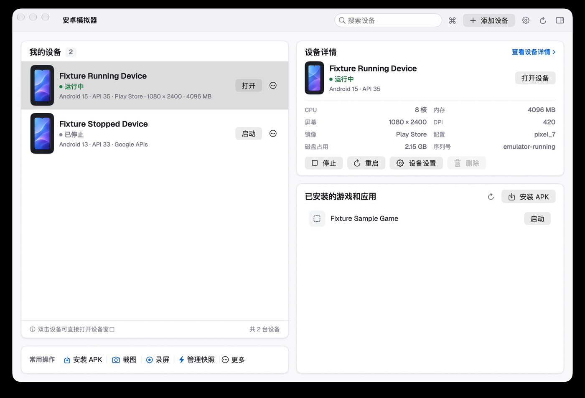
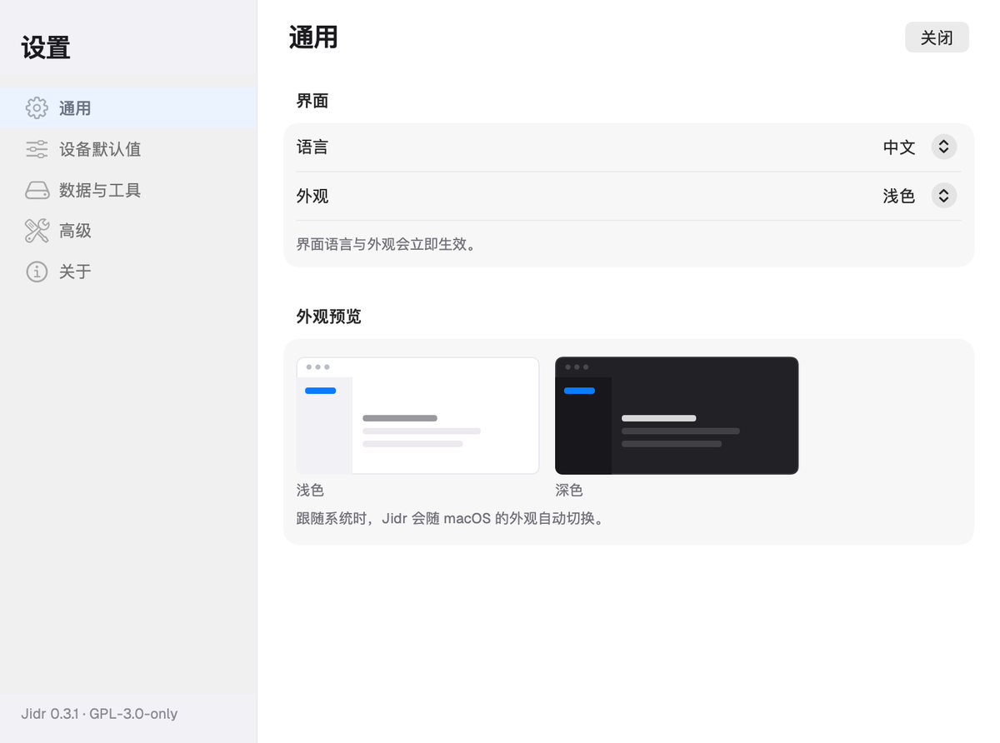
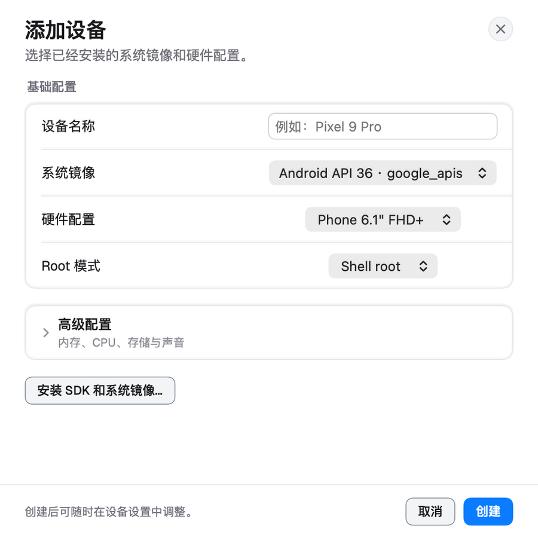
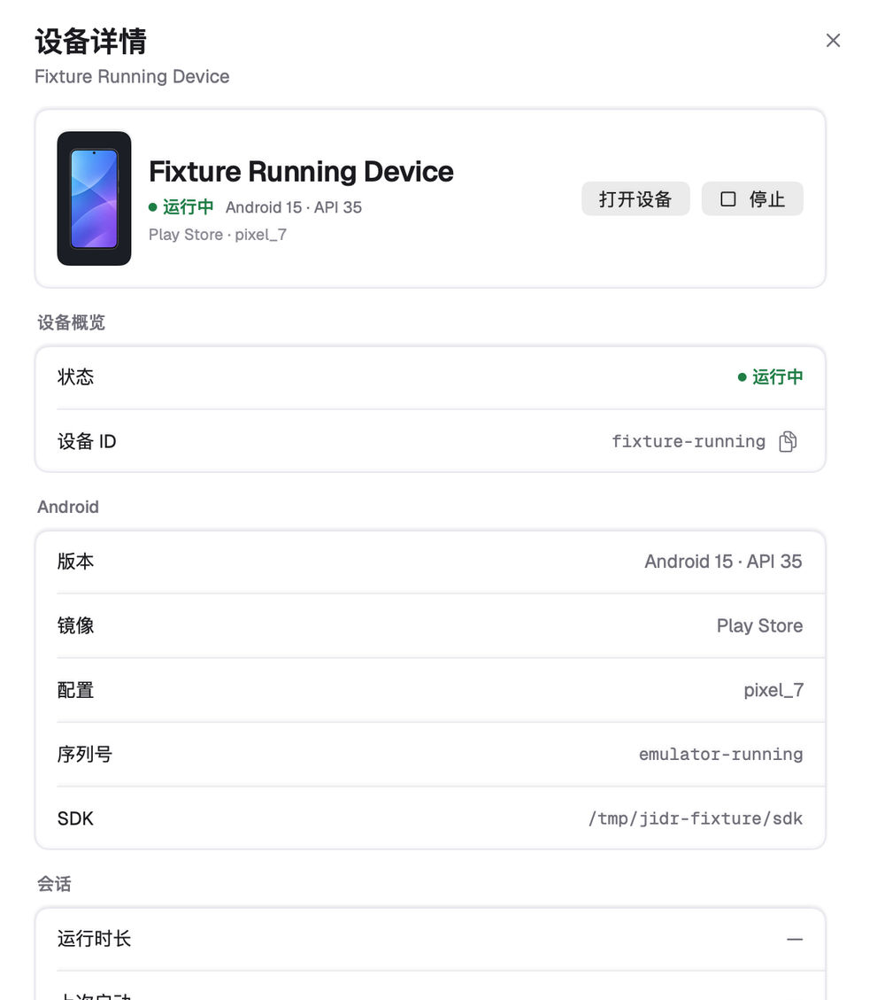
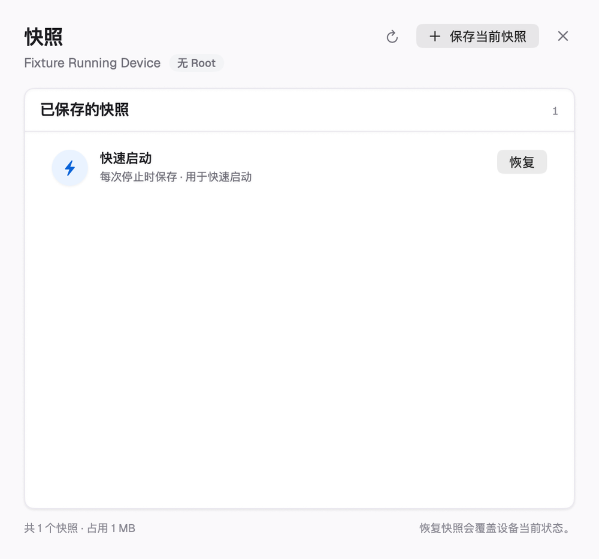
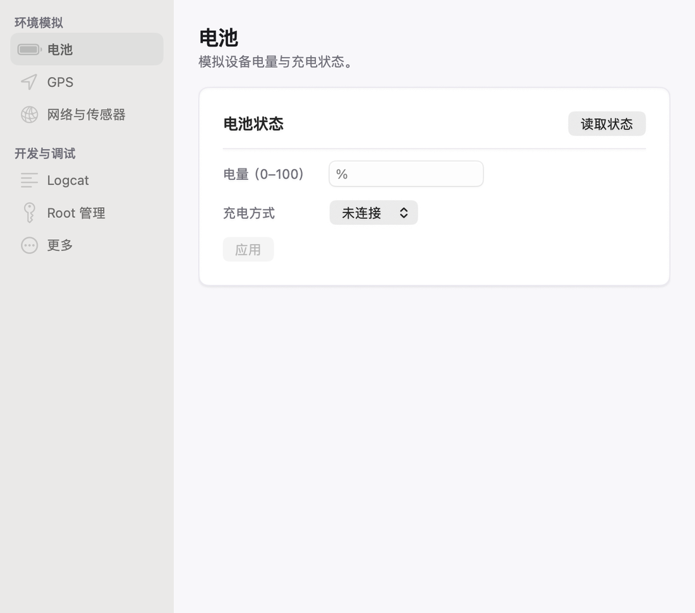
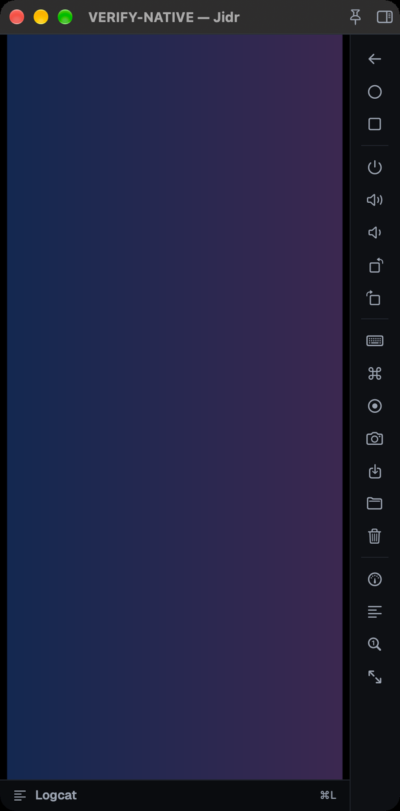

# SwiftUI visual refresh (2026-11)

The SwiftUI centre, settings window, sheets and player chrome were refreshed on top of the
existing information architecture. The Slint app keeps its own layout and is still the fallback,
but it consumes the same `tokens.json` palette (the theme file is regenerated by its build
script), so the two UIs share colour, radius and type roles even while their layouts differ.

## Direction

- Light-first macOS surface: window ground `#F8F7FA`, white cards with a 1px `#E9E7EE` hairline
  and the soft elevation-1 shadow, a warmer chrome bar, and the system-blue accent `#0A7CFF`.
- Hierarchy over decoration: cards separate regions, hairline dividers separate rows, status is a
  6pt dot plus a label (no coloured pills), and secondary text is quieter than the primary action.
- Tokens stay the single source (D41): the refresh edits `docs/design/tokens.json` and both UIs
  regenerate from it. The SwiftUI-only component layer is
  `apps/jidr-swiftui-prototype/Center/DesignKit.swift` (cards, form rows, status labels,
  thumbnails, buttons, sidebar rows).
- The design references and full-page mockups live in `outputs/redesign/` (not tracked); the
  implementation screenshots below are rendered from the product views against the bridge
  fixtures with the same 2x offscreen pipeline as the snapshot matrix.

## Pages

| Page | Screenshot |
|---|---|
| Device centre (two columns: devices, details, apps, common actions) |  |
| Settings — General (sidebar + grouped form + appearance preview) |  |
| Add device (sheet, basic + advanced disclosure) |  |
| Device details (overview, Android, session, hardware, root) |  |
| Snapshots (quick-boot row, restore/delete, footer summary) |  |
| Advanced tools (battery tab, grouped side navigation) |  |
| Emulator window (dark native chrome, side rail, logcat bar) |  |

## What changed in the product

- `Center/DeviceViews.swift`: `CenterView`, `SettingsView`, `NewDeviceView`, `EditDeviceView`,
  `DeviceDetailsView` now use the design kit. Device rows carry the inline primary action plus an
  overflow menu (settings, restart, delete); the detail and app columns keep every existing
  action; the common-actions strip is a flat row with an overflow menu for the less-used actions.
  All existing strings, accessibility labels/hints, keyboard shortcuts, busy/progress states,
  alerts, sheets and the compact (<940 pt) layout are preserved.
- `Center/SnapshotsView.swift`, `Center/SnapshotDialogs.swift`, `Center/AdvancedTools.swift`:
  the same card/group/row vocabulary; the advanced-tools shell gained the grouped side navigation
  while every tool form, protocol call and warning is unchanged.
- `Sources/PlayerWindowView.swift`, `Sources/GameWindow.swift`: dark token chrome, hairline under
  the native title bar, 28pt tool buttons with hover/active states, a slimmer logcat bar, and the
  two titlebar accessory buttons restyled. Input, recording, snapshots, window sizing and state
  restore are untouched.

## Native controls pass (2026-11)

The first visual pass had replaced several standard controls with custom SwiftUI
drawings. They now use the AppKit-backed components again, while the card/token
surfaces stay:

- the centre search is a real `NSSearchField` (native clear button, focus
  restore after the palette/task overlay closes, Esc clears);
- toolbar icons are `.borderless` buttons;
- the device list and installed-app list are native `List(selection:)` rows;
- the settings and advanced-tools sidebars are native sidebar `List`s;
- the settings pages are a grouped `Form` with `Section`s (all fields, alerts and
  the static appearance preview are preserved);
- the snapshot list is a native `List`, and the player side rail plus logcat
  strip are borderless buttons.

Still intentionally custom: the centre's title-bar row (an `NSToolbar` move is a
larger separate change), cards, group labels, status dots, device artwork,
sheet headers/footers, the player's dark chrome background, and the command
palette/task centre overlays. The screenshot baselines were regenerated after
this pass; `test.sh` and the window-lifecycle test still pass.

## Deviations from the design mockups

The mockups assumed a few data sources the product does not have, so the implementation keeps the
real behaviour instead of inventing features:

- Device thumbnails use the existing `DeviceArt` artwork; live screen thumbnails would require a
  new screenshot pipeline.
- Installed apps are rows with the real icon when the daemon reports one, and an SF placeholder
  otherwise; the mockup's coloured icon grid is not reproduced.
- Settings keeps only the real fields; the mockup's "new device preview" was dropped (the
  appearance preview is a static illustration of the current appearance setting).
- Device details render the real session/hardware/root fields (ports, process id, uptime) rather
  than the mockup's sample values.
- The player keeps the native title bar (traffic lights + system title) and the 48pt side rail, as
  required by the window-sizing/pixel-perfect math.

## Verification

- `bash apps/jidr-swiftui-prototype/test.sh` — PASS (logic suites + localization gate; 0 new
  English-mode leaks; the gate reports 12 non-blocking stale `.strings` keys that the rewritten
  views now call through `model.text`).
- `bash apps/jidr-swiftui-prototype/test-window.sh` — game-window lifecycle PASS.
- `bash apps/jidr-swiftui-prototype/snapshot.sh --check` — 11/11 baselines PASS after regeneration.
- `bash apps/jidr-swiftui-prototype/generate-tokens.sh --check` — token files in sync.
- `cargo xtask ci` — 605 tests passed, 1 skipped; licence and skills checks pass.
- Product-view renders against the fixture bridges are in `target/impl-shots/` (untracked) and were
  reviewed page by page; the screenshots above come from them.
