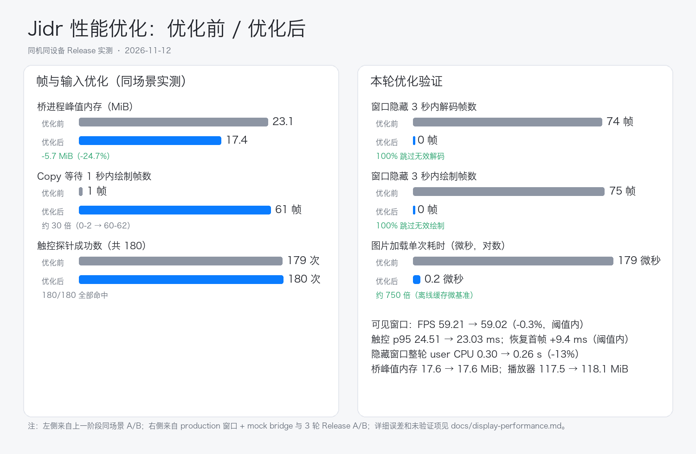

# Native player measurements

Build and run the current harness with `bash apps/jidr-swiftui/bench-player.sh --help`.
`--self-test` runs offline checks. Live measurements use an already running disposable
device and explicit panel size; latency probes require show-taps to be enabled. Results
are written with `--json-out PATH`. Compare like-for-like device, scene, screen refresh
rate, window size and quality. These measurements do not prove game/audio compatibility.

## Shared frame payload comparison (2026-11-12)

The bridge now keeps immutable RGBA pixels alive with `Arc<Vec<u8>>`. A sole stdout
writer emits the unchanged JFR1 header and pixel payload using `write_all`. The
shared path reserves the one waiting-frame slot before rotation/packet preparation;
the existing drop-new-on-full rule and input/orientation scheduling are retained.
At the measured 576×1280 stream size, this removes a 2.8125 MiB packet-payload
copy per unrotated frame. A rotated frame still needs its rotated pixel buffer.
`JIDR_PLAYER_FRAME_TRANSPORT=legacy` selects the copied-packet rollback branch.

Reproduce with an installed clean SDK and a disposable real device:

```bash
python3 scripts/test-player-baseline.py
python3 scripts/player-baseline.py --sdk /absolute/path/to/clean-test-sdk \
  --compare-frames --seconds 20
```

Primary measurement revision: `b314318`. Same Release executable/bridge hashes
for both modes; 3 pairs, ordered legacy/shared, shared/legacy, legacy/shared.
Both branches use the same bounded Tokio channel, which isolates payload sharing
and admission work. The earlier complete executable's std channel is outside this
same-binary comparison. Host: macOS 27.0.1, 24 GiB RAM, 120 Hz display. Fixed real
device: Android 36 arm64, 1080×2400, 4 cores/4096 MiB, root none, quality 1;
stream 576×1280, window screen area 340×752 points. Each run scrolls Android
Settings for 20 seconds, then uses 30 show-taps probes and 3 minimize/restores.

| Metric | Copied (`legacy`) | Shared |
| --- | ---: | ---: |
| Bridge peak physical footprint, median of runs | 23.1 MiB | 17.4 MiB |
| Player harness peak physical footprint, median of runs | 132.1 MiB | 132.9 MiB |
| Displayed FPS, median of run averages | 59.31 | 59.56 |
| Draw interval p95, median of per-run p95s | 19.44 ms | 19.10 ms |
| Touch-to-draw p95, median of per-run p95s | 28.22 ms | 27.71 ms |
| Worst observed touch sample | 31.62 ms | **178.07 ms** |
| Worst fresh restore (includes macOS animation) | 542.03 ms | 560.30 ms |
| Bridge CPU, median of runs, 100% = one core | 15.15% | 12.77% |

The component peak-footprint saving is 5.7 MiB (24.7%) in this comparison. CPU
and latency are short-scene observations. Footprints are per process; center,
daemon and emulator memory were excluded. Touch ends at `ScreenView.draw`,
excluding physical input delivery and GPU scanout. All 180 primary touch probes
and 18 fresh restores were detected. The predeclared short-scene limits in the
SwiftUI README passed; frame interval tails were retained without filtering.

### Long-tail investigation and remaining acceptance

The shared path's third primary run had 65 ms and 178 ms touch samples. They are
retained in the evidence and prevent any claim that long-tail input is solved.
Supplemental measurement revision `d8cec95` adds only harness timelines and uses
the **identical bridge binary**. Two more pairs use 30 seconds of scrolling and
100 touches per run, in forward/reverse order:

- Shared: 200/200 detected, per-run p95 29.91/29.57 ms, maximum 33.44 ms.
- Legacy: 199/200 detected; its second run's probe 93 timed out. This supplemental
  comparison remains **failed** (`manifest.complete=false`) and is excluded from
  the passing primary comparison. Its first run had 79/80/135 ms touch samples.
- At those legacy long touches, overlapping receive gaps were 271/335/388 ms,
  with nearby main-queue lag about 0.02–0.04 ms. The missed probe overlapped a
  718 ms receive gap. This suggests bridge/upstream waiting; it does not identify
  a particular command or prove the cause of the primary shared outlier.

The evidence supports retaining this frame-memory optimization within the tested
scene. Input scheduling and its existing intermittent gaps require their own FIFO,
held-key/multitouch/IME/copy-cut acceptance. Real rotation, Space/fullscreen, games
and long-duration memory behavior remain unverified here. Keep the legacy switch
available during those follow-up tests.

Local evidence (ignored by Git):
`target/performance/shared-frames-ab-20261112/{manifest.json,comparison.json,run-*.json}`
and `target/performance/shared-frames-tail-20261112/{manifest.json,run-*.json}`.
Both series stopped/deleted their own devices/daemons, removed their isolated
homes, and verified the test SDK ramdisk hash was unchanged. Regression checks:
473 Rust tests passed/1 skipped, full Swift logic/localization checks, 26 visual
snapshots, player lifecycle checks, 65 benchmark self-tests and 4 runner tests.

## Before/after verification (2026-11-12)



Two verifications were run after the center/visibility changes. They answer
different questions and are not interchangeable with the earlier scenarios.

### Visible-player Release A/B (same device)

The before revision is `14dbad2` (the end of the previous performance phase);
the after revision is `0c82737` (this round's performance commits plus the
merged operation-recording feature). Both used the same clean SDK/image,
disposable Android 36 arm64 device, 576×1280 stream, quality 1, 340×752-point
window, Settings scroll for 10 s, 30 show-tap probes and 3 minimize/restores.
Three runs per revision; all probes completed and both manifests report
`complete=true`, unchanged SDK ramdisk and removed isolated homes.

| Metric (median of 3 runs) | Before `14dbad2` | After `0c82737` | Result |
| --- | ---: | ---: | --- |
| Displayed FPS | 59.21 | 59.02 | -0.3%; within 5% limit |
| Touch-to-draw p95 | 24.51 ms | 23.03 ms | -6%; within `max(5 ms, 20%)` limit |
| Bridge peak physical footprint | 17.6 MiB | 17.6 MiB | unchanged median |
| Player peak physical footprint | 117.5 MiB | 118.1 MiB | +0.6 MiB; within 10% limit |
| Worst fresh restore | 550.89 ms | 560.32 ms | +9.4 ms; within +50 ms limit |
| Bridge CPU | 12.94% | 13.52% | within run-to-run noise |
| Player CPU | 26.96% | 27.93% | within run-to-run noise |

The after binary is a merge that adds the operation-recording feature, so this
A/B is primarily a no-regression check for the visible player, not evidence of
a foreground FPS gain. The new center, image-cache and hidden-window work does
not target the visible Settings-scroll scene.

### Hidden-window component measurement

A temporary harness compiled against the same production
`GameWindowController`/`PlayerTransport` sources drove a 30 fps mock bridge,
showed the window for 1 s, minimized it for 3 s, then restored it. Before is
`14dbad2`, after is `0c82737`; the harness and bridge were otherwise identical.

| 3 s minimized window | Before | After |
| --- | ---: | ---: |
| Frames decoded | 74 | **0** |
| Frames drawn | 75 | **0** |
| Whole-run user CPU | 0.30 s | 0.26 s |
| Retired instructions | 2.96 B | 2.65 B |
| Peak memory footprint | 102.1 MB | 99.6 MB |

The bridge stayed alive; on restore the first new frame was decoded after the
restore event. This is a component check with a mock bridge, not a real-device
minus/restore CPU measurement; real occlusion/Space/fullscreen acceptance is
still outstanding.

### Center and image changes

The center now coalesces ordinary device events into at most one `device.list` +
`jobs.list` pair per 120 ms (boot progress does not trigger a full refresh),
single-flights both queries and moves NDJSON/JSON parsing and the device/jobs
list decoding off the main thread. This was validated by the existing center
logic/UI regressions; a live CPU profile of a real device boot was not run.

`WbAppIcon`/`DeviceArt` now hit a bounded `NSCache`; an offline microbenchmark
on the same PNG measured direct `NSImage(contentsOfFile:)` at 0.179 ms per call
versus 0.0002 ms for a cache hit (about 750x). `FrameDecoder` removes two tiny
header array allocations per frame; its per-frame pixel buffer remains owned by
the CGImage provider.

Still deferred: the 750 ms ADB orientation poll, the drop-newest bridge
admission policy, real-game/IME/rotation/Space/long-run acceptance, and a
release-package regression on the final signed artifact.

## Center refresh, parsing and hidden-window gating (2026-11-12)

The center model no longer performs one full `device.list` + `jobs.list` per
device event. Ordinary events coalesce into a 120 ms trailing refresh; boot
progress updates its fraction directly without a full refresh, while boot
failures, errors and mutation-triggered refreshes stay immediate. Both list
queries are single-flight with a trailing request and generation/session guards
so stale replies cannot win. NDJSON framing and `JSONSerialization` moved to a
serial parse queue, and the large device/jobs list payloads decode on a separate
queue before the main thread applies them. Unchanged device/job payloads are no
longer republished to SwiftUI.

`WbAppIcon`/`DeviceArt` now share a bounded 64-entry `NSCache` (including misses)
instead of loading `NSImage` inside every body evaluation. `FrameDecoder` reads
the four magic bytes and header words directly, removing two tiny array
allocations per frame; the pixel buffer allocation is intentionally retained
because the downstream `CGImage` provider owns it.

The player transport tracks native window visibility (occlusion, minimize,
active Space, app hide). While hidden it still drains/parses the bridge stream,
but skips `CGImage` creation, pending-frame replacement and main-thread display
scheduling; the first frame decoded after the window returns is shown, never the
pre-hide image. Host/SDK combinations that report no usable `.visible` occlusion
flag fall back to the other visibility signals so a shown window is not frozen.
Recording, screenshots and the emulator stream are not paused. The local suites
and the 26-image snapshot matrix pass; hardware occlusion/Space/fullscreen and
real-device timing still need dedicated acceptance.

Not changed here: the bridge's 750 ms ADB display-orientation poll and the
drop-newest frame admission policy. Both remain deferred until a disposable
device is available for rotation/multitouch and sustained-load measurement.

## FIFO input and independent connection (2026-11-12)

The input path now has one bounded FIFO consumer and one input-state owner.
Frame reception runs independently of its RPC awaits. FIFO mode also creates
an actual second gRPC connection: cloning a Controller would share the
screenshot connection and its HTTP/2 transport resources. The native animated
Copy check failed with the shared connection and passed with the independent
connection. Existing media/app job tasks retain their previous behavior.

Potential downs are tracked before a request can be delivered. Acknowledged
ups remove them. EOF drains the queue; frame/output loss, SIGTERM and Ctrl-C
cancel pending work and attempt held-input releases in reverse press order.
Temporary clipboard-chord keys are included, and cancellation during an error
recovery retains unfinished releases. Each release attempt has a one-second
bound. The screenshot stream is dropped before releasing inputs. SIGTERM keeps
its immediate default behavior during startup before inputs can be delivered.
`JIDR_PLAYER_INPUT_SCHEDULER=inline` retains coupled scheduling/shared transport
for rollback; `fifo` is the default. Both branches use the current release-safety
fixes. This is a same-binary comparison of scheduling/connection isolation.

### Controlled real-emulator evidence

Revision `c8f7dab`, Release, same benchmark and bridge hashes for all six runs.
The host/device/stream/window/quality configuration matches the shared-frame
comparison above. Three pairs reverse order in the middle pair. Each run uses
20 seconds of continuous drawing/gesture traffic, 3 clipboard-wait windows,
60 touch probes and 3 native minimize/restores. Shared frame transport is fixed.

The Android fixture continuously moves a bar away from the touch-sampling
patch. Its benchmark mode consumes C without changing the clipboard, modeling
an app that does not implement Copy. Each real Copy request therefore waits for
the existing fresh-clipboard timeout while animation continues. Trace-file writes
are disabled for timing runs. Volume Up replaces Home to keep this scene visible.

| Metric | Inline/shared connection | FIFO/independent connection |
| --- | ---: | ---: |
| Frames drawn in each first ~1s Copy wait | 0–2 | **60–62** |
| Copy-wait windows captured | 9 | 9 |
| Gesture-phase FPS, median of runs | 59.68 | 59.64 |
| Touch p95, median of per-run detected-sample p95s | 22.80 ms | 22.64 ms |
| Detected touches | **179/180 (1 missed)** | **180/180** |
| Fresh restores | 9/9 | 9/9 |
| Worst fresh restore, including macOS animation | 573.92 ms | 573.63 ms |
| Bridge peak physical footprint, median of runs | 20.3 MiB | 20.4 MiB |
| Player harness peak physical footprint, median of runs | 126.2 MiB | 126.1 MiB |

Every FIFO wait window exceeded the predeclared 45 drawn-FPS/twice-inline
target. All three candidate runs passed the FPS, touch-p95, restore and
per-process footprint limits in the README. One-second boundaries may include
an already-received pending image, explaining counts slightly above 60. This
shows continued rendering during a specific input wait; ordinary typing latency
and non-waiting FPS were essentially unchanged. No CPU saving is claimed for
doing the rendering that the inline path skipped while frozen.

**Candidate acceptance passed; the complete comparison suite remains failed.**
The inline baseline missed one touch, so `manifest.complete=false` and the runner
exited nonzero. `collection_complete=true` says all six runs were captured.
The failed probe is retained and the baseline's p95 covers detected samples
only; it cannot establish a general tail-latency improvement.

### Native input/release checks and regression tests

Before timing, the production bridge drives a debug APK built from the checked-in
Android fixture using the already installed SDK/JDK and an ephemeral test key.
The fixture records its actual Android events/text in private files read by
`adb run-as`. Its normal Copy handler is enabled for functional checks. All six
checks passed under continuously changing frames:

- Modifier plus held-letter down/up behavior.
- Chinese/Japanese/Emoji paste replacing a selection.
- Copy returning fresh Android clipboard text.
- Cut updating the clipboard and removing the selected text.
- A two-finger gesture with a final up.
- Actual SIGTERM while keys and both fingers remain held, followed by observed
  Android key/touch releases and a normal bridge exit.

Offline input regressions cover
bounded FIFO ordering/repeats, cancellation at all four chord steps, cancellation
during recovery, ambiguous/lost replies, mapped-touch release after rotation and
bounded cleanup. Full validation: 484 Rust tests passed/1 skipped, Swift logic
and localization checks, 26 visual snapshots, player lifecycle checks,
68 benchmark self-tests and 6 runner tests.

### Evidence retained and scope

Local artifacts are under `target/performance/input-fifo-controlled-v3-20261112/`:
`manifest.json`, `comparison.json`, `run-*.json`, `input-smoke/report.json`, the
Android event trace/RPC-stage log and the fixture's source/APK hashes. RPC tracing
records method/status/timing only, is enabled for the native functional check,
and is disabled in timing runs and normal launches. The test app was uninstalled;
device, daemon and isolated home were removed. The test SDK ramdisk hash matched.

Earlier results remain available:

- `input-fifo-ab-20261112`: ordinary Home/static-screen series, 178/180 touches
  in each mode. Both paths had misses. Content-change demand confounded input-
  phase receive-rate measurements, so this series did not prove independence.
- `input-fifo-controlled-20261112`: aborted initial animated-fixture input check;
  no timed runs. The harness subsequently added window-focus readiness and
  explicit initial-touch delivery checks, plus saved layout/text diagnostics.
- `input-fifo-controlled-v2-20261112`: Unicode paste passed, then animated Copy
  failed before its chord reached Android with the shared connection. No timed
  runs. Input transport was subsequently isolated before the successful v3 check.

Hardware macOS IME composition, games, free rotation during gestures,
fullscreen/Space and long-duration stability remain separate acceptance. These
results cover the real emulator and the current native player rendering path;
they exclude physical input delivery and GPU scanout and do not prove those
broader scenarios or whole-application memory savings.

## Historical Slint measurements (2026-11-09)

The implementation and command described below were retired on 2026-11-11; this is
retained measurement evidence, not a runnable current entry point.


`cargo run -p jidr-ui --example display_bench -- "<running device name>"` opens a separate, read-only window connected to an already running device. It does not send keys, touch, clipboard operations or application launches. The test requests half the device's width and height. It measures three 10-second intervals: visible, minimized, and restored. Set `JIDR_DISPLAY_BENCH_SECS` to 3–60 to change each interval. CPU is process CPU as a percentage of one core; on systems without `ps` it is reported as unavailable. Frame rate and throughput are receiver-side measurements, not the Android game's own render rate. Minimize/restore transitions can cause a few frames in the adjacent interval.

The source uses the same `Session` and native occlusion notification used by the game window. Compare runs on the same device, screen, window size, game scene and machine; record emulator CPU and RAM separately. This benchmark does not prove touch latency, audio playback, game correctness, or long-running memory stability. It briefly creates an additional screenshot stream, which adds load to the running emulator.

A local debug-build observation on 2026-11-09, Android 15 arm64, 1080×2400 device, 540×1200 stream, 8 seconds per interval:

| Interval | Received fps | Displayed fps | MB/s | GUI CPU, one core = 100% |
| --- | ---: | ---: | ---: | ---: |
| Visible | 59.97 | 58.72 | 155.45 | 61.3% |
| Minimized, including animation | 4.37 | 0.25 | 11.34 | 0.7% |
| Restored, including animation | 56.00 | 55.88 | 145.15 | 55.8% |

This measures the optimization for a minimized/occluded window. It is not a claim that foreground streaming uses less CPU than the previous version. For a separate foreground baseline, hold a comparable scene and window size constant, and compare builds in isolated runs.
